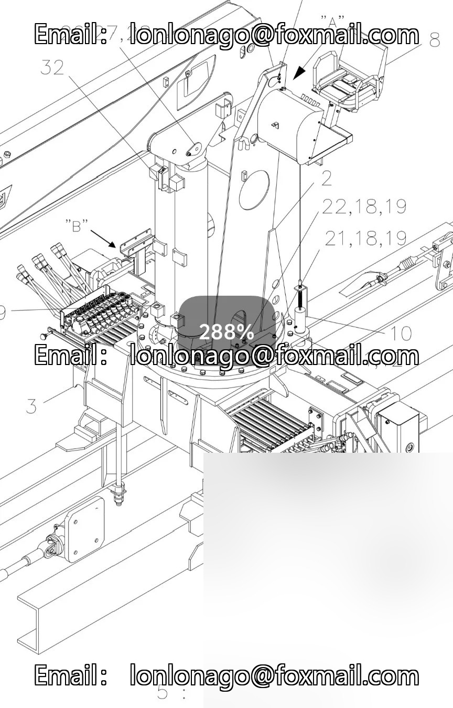
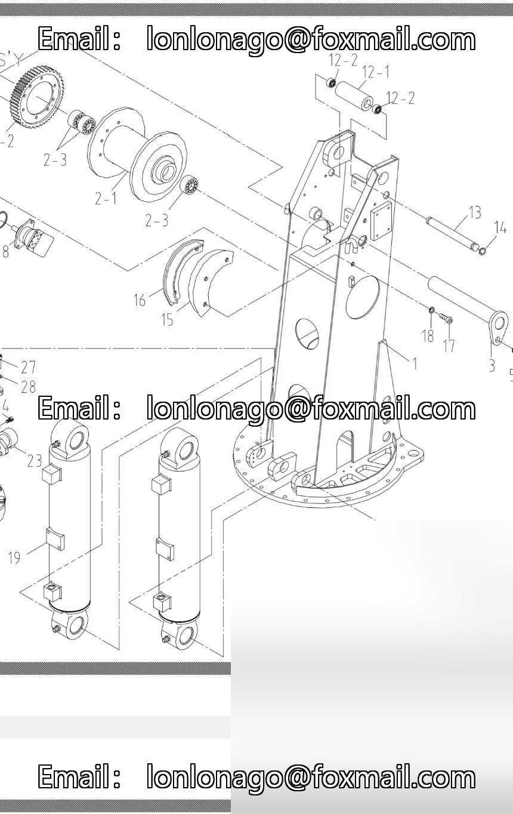
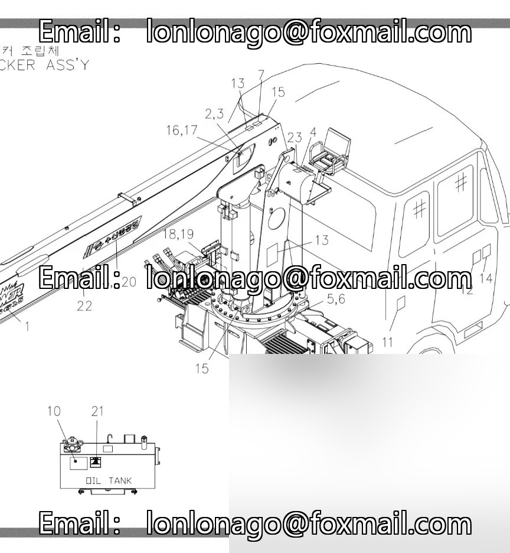
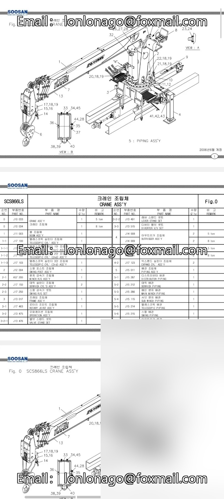

# DOOSAN (Doosan) hydraulic crane component manual PDF electronic edition 28

## Body

Doosan (Doushan) hydraulic crane parts manual PDF , 280 pages
Suitable for 7-ton hydraulic cranes, covering structural diagrams, part details, installation and maintenance instructions.
Suitable for maintenance, spares procurement, and technical reference.
link uploaded to cloud drive for download.
35193

This is the DOOSAN (Doushan) hydraulic crane part manual, 28 pages, applicable to 7-ton-class hydraulic cranes, covering structural diagrams, part details, installation and maintenance instructions, along with an index of related items.

<!-- AI_ENRICHED -->

## Images

## Payment

Here is a pay link on Stripe ( https://buy.stripe.com/3cs8yP7sY87d0vu9AB ). Please contact me lonlonago@foxmail.com after funding $89, and I will send you a complete data files , thank you!

